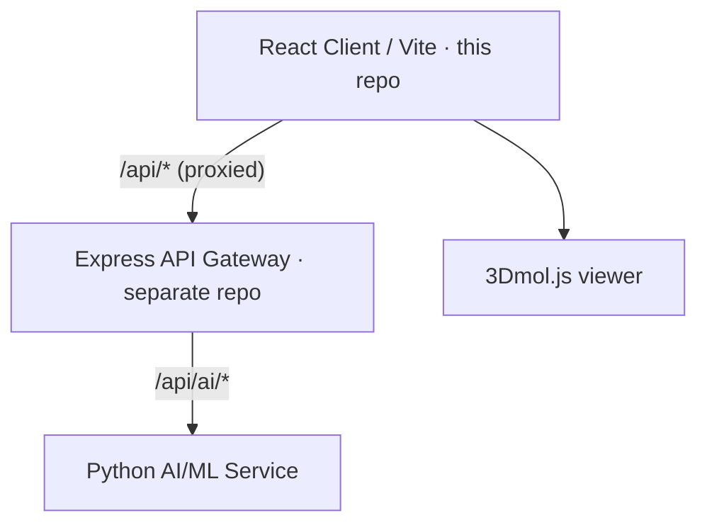

# Hakase BioTwin — Frontend

Web client for the **Hakase BioTwin** preclinical digital-twin platform: a React + Vite
single-page app with a dark-mode glassmorphic design system and real-time 3D
protein–ligand visualization. The API gateway and AI/ML services live in a separate
repository: **[hakase-bio-backend](https://github.com/Hakase-ai/hakase-bio-backend)**.

> Process management is **PM2-based** (no Docker required). All configuration is read
> from a local `.env` file — nothing environment-specific is hardcoded, and `.env` is
> never committed.

---

## Architecture



### Components in this repo

| Path | Purpose | Stack |
| --- | --- | --- |
| `artifacts/hakase-ai` | **Main web app** | React 19, Vite 7, TypeScript, TailwindCSS, wouter, TanStack Query, 3Dmol.js, RDKit-JS |
| `hakase-website` | **Marketing site** | Next.js content site |
| `frontend/config/ecosystem.config.cjs` | **PM2 config** | App definition; loads `.env` |
| `ecosystem.config.js` | **PM2 entry** | Root canonical entry — re-exports the config above |
| `lib/` | **Shared packages** | `api-client-react`, `preclinical-handoff` |

The app talks to the backend using **relative** endpoints (`/api/auth/*`, `/api/ai/*`).
In development these are proxied by Vite to the API gateway; in production they are served
from the same origin (or routed by nginx), so no API base URL is hardcoded.

### Routing & default dashboard

Routes are defined in `artifacts/hakase-ai/src/App.tsx`. After a successful login the
default destination is the **Lab dashboard at `/lab`**. If a signed-out user is bounced
to `/login` from a protected page, the original page is preserved via `?next=` and they
return there after authenticating. Authenticated routes: `/lab` (default), `/dashboard`,
`/screen`, `/ivive`, `/advanced-v2`, `/haiopsdna`.

---

## Prerequisites

- **Node.js** ≥ 20
- **pnpm** ≥ 10 (workspace package manager — do **not** use `npm`/`yarn`)
- **PM2** (`pnpm add -g pm2`) — for production process management
- A running **backend** (see the
  [hakase-bio-backend](https://github.com/Hakase-ai/hakase-bio-backend) repo)

---

## 1 · Configure environment

All settings come from `.env` at the repo root. Copy the template and fill it in:

```bash
cp .env.example .env
```

Key values (see `.env.example` for the full, documented list):

```env
PORT=4000                              # Vite dev/preview server port
BASE_PATH=/                            # app base path
API_PROXY_TARGET=http://localhost:3000 # dev-only: where /api/* is proxied (the API gateway)
NODE_ENV=development
```

> **Never commit `.env`.** It is git-ignored.

---

## 2 · Install dependencies

```bash
pnpm install
```

---

## 3 · Run in development

```bash
pnpm run frontend:dev
```

- Vite dev server → `http://localhost:${PORT}` (default `4000`)
- `/api/*` is proxied to `API_PROXY_TARGET` (the backend API gateway on `:3000`)

Start the backend separately from its repo so the proxied API calls resolve.

---

## 4 · Build & verify

Always confirm a clean build before pushing:

```bash
pnpm run build      # typecheck across the workspace, then vite build → artifacts/hakase-ai/dist/public
```

---

## 5 · Run in production (PM2)

Process management is handled entirely by PM2 using the root `ecosystem.config.js`:

```bash
pnpm install && pnpm run build               # build static assets first
pm2 start ecosystem.config.js --env production
pm2 save
pm2 startup                                    # (once) generate boot script
```

Common operations:

```bash
pm2 reload ecosystem.config.js --update-env   # zero-downtime reload
pm2 stop   ecosystem.config.js
pm2 logs
pm2 status
```

PM2 manages one app, `hakase-frontend` (Vite preview server over the built `dist/`).
On hosts that serve static files via **nginx**, this PM2 unit is optional — point nginx
at `artifacts/hakase-ai/dist/public` directly (sample config in `frontend/nginx/`). All
PM2 env values are loaded from `.env` at start time.

---

## Deployment workflow

- Push application changes to the **`staging`** branch only — never directly to
  `main`/`master` or any production branch.
- Verify `pnpm run build` succeeds before pushing.
- `.env`, secrets, API keys, and build output (`dist/`, `node_modules/`) are git-ignored
  and must never be committed.

---

## Repository layout

```
.
├── ecosystem.config.js               # root PM2 entry (re-exports frontend/config)
├── artifacts/
│   └── hakase-ai/                     # main React + Vite app
│       ├── src/App.tsx               # routes (default post-login → /lab)
│       └── vite.config.ts            # dev proxy via API_PROXY_TARGET
├── hakase-website/                   # Next.js marketing site
├── frontend/
│   ├── config/ecosystem.config.cjs   # PM2 app definition
│   ├── scripts/                      # start / build / preview helpers
│   └── nginx/ · systemd/             # sample host configs
├── lib/                              # shared workspace packages
├── .env.example                      # documented env reference (copy to .env)
└── pnpm-workspace.yaml
```
