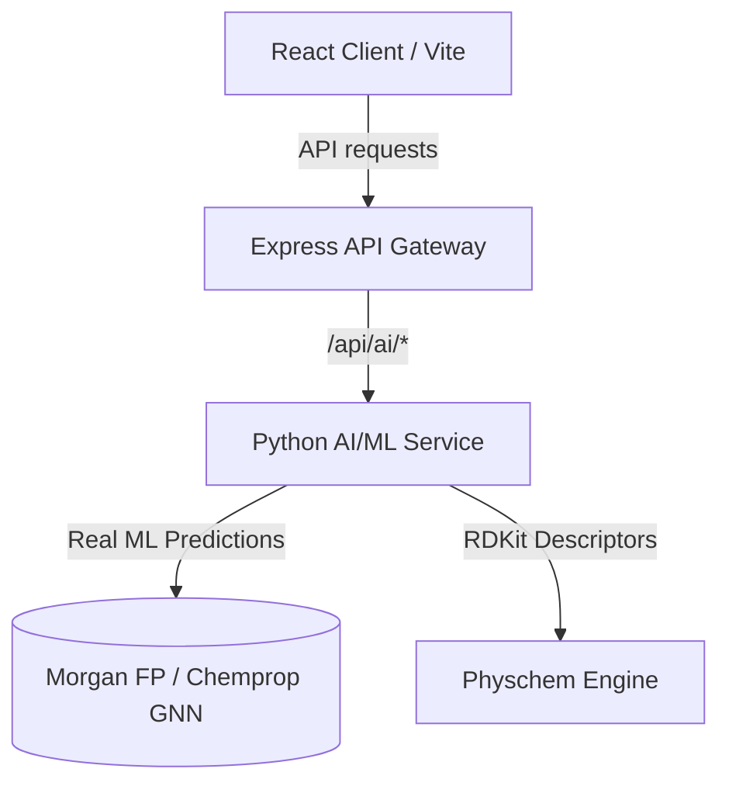

# Hakase BioTwin Preclinical Digital Twin Platform

Hakase BioTwin is a state-of-the-art, full-stack preclinical digital twin simulation platform. It integrates advanced physical chemistry analysis, structural mutagenicity scans, 3D molecule structural visualization, in silico/ex vivo safety assays, and high-fidelity Machine Learning model predictions (Graph Neural Networks and Random Forests) to profile drug candidates and evaluate regulatory IND readiness.

---

## 🏗️ Platform Architecture

The system is organized as a multi-tier microservice architecture:



### 1. **Frontend: React Application (`/artifacts/hakase-ai`)**
*   Built with React, Vite, TypeScript, and Framer Motion.
*   Uses a dark-mode glassmorphic design system for a premium scientific look.
*   Integrates `3dmol` for real-time 3D structural protein-ligand viewer interaction.
*   Communicates with the API gateway using relative endpoints (e.g. `/api/ai/*`), fully proxied in development mode.

### 2. **API Middleware: Express Gateway (`/artifacts/api-server`)**
*   Built with Express and TypeScript.
*   Handles request validation, database interactions (Drizzle ORM + SQLite), and therapeutic area modifiers.
*   Reverse proxies `/api/ai/*` to the downstream Python machine learning service.

### 3. **AI/ML Engine: Python Service (`/artifacts/ai-service`)**
*   Powered by Flask, RDKit, SciPy, and Scikit-Learn.
*   Performs structural pharmacophore scans (Ames mutagens, DILI risks, hERG block indicators).
*   Consists of three primary production-ready machine learning engines:
    *   **DILI-ML:** A Random Forest classifier trained on the FDA DILIrank dataset ($n=475$ compounds) utilizing Morgan fingerprints and RDKit descriptors.
    *   **CardioTox ML (DeepHIT):** A Random Forest model trained on ChEMBL ($n=655$ assays) to predict hERG channel blocking probabilities.
    *   **ADMET-AI:** A pre-trained deep Graph Neural Network (**Chemprop GNN ensemble**) predicting 41 endpoints directly from molecular structure.

---

## 🛠️ Developer Guide & Startup Instructions

Follow these instructions to start the full-stack suite locally.

### 1. **Prerequisites**
Ensure you have the following installed on your machine:
*   **Node.js** (v20 or higher)
*   **pnpm** (Required package manager, do not use `npm` or `yarn`)
*   **Python** (v3.11 or higher)
*   **Git** & **Git LFS** (required for model weight storage)

---

### 2. **Installation**

#### Step A: Install JS Dependencies
From the repository root, install the pnpm workspace dependencies:
```bash
pnpm install
```

#### Step B: Install Python Dependencies & Model Warmup
Create a virtual environment, activate it, and install dependencies from the workspace root:
```bash
python -m venv .venv
source .venv/bin/activate
pip install -r pyproject.toml
```

If your NumPy/RDKit versions complain, ensure they are pinned correctly (NumPy 2.x and RDKit 2026.x compatible packages are fully supported).

---

### 3. **Starting the Services (Local Dev)**

You can start the full stack using the built-in workspace scripts in two separate terminal windows (recommended), or start the individual services manually.

#### Option A: Using the Workspace Scripts (Recommended)

1.  **Terminal 1 (Backend)**: Start both the Python AI/ML Service and the Express API server concurrently:
    ```bash
    pnpm run backend:legacy
    ```
    *   **API Server:** `http://localhost:3000`
    *   **AI Service:** `http://localhost:8090`

2.  **Terminal 2 (Frontend)**: Start the Vite React client dev server:
    ```bash
    pnpm run frontend
    ```
    *   **Frontend Client:** `http://localhost:3001` (or `http://localhost:4000` depending on port availability)

---

#### Option B: Starting Services Manually

If you prefer to run the services individually:

1.  **Python AI/ML Service**:
    ```bash
    cd artifacts/ai-service
    python main.py
    ```
    *   **URL:** `http://localhost:8090` (Configure `AI_SERVICE_PORT` in `.env` if needed)

2.  **Express API Middleware**:
    ```bash
    PORT=3000 DATABASE_URL="file:local.db" pnpm --filter @workspace/api-server dev
    ```
    *   **URL:** `http://localhost:3000`

3.  **Vite React Frontend**:
    ```bash
    PORT=3001 BASE_PATH="/" pnpm --filter @workspace/hakase-ai dev
    ```
    *   **URL:** `http://localhost:3001`

---

## 🧪 Verification & Health Check

Once the services are running, you can verify their connection and health:

1.  **AI/ML Service Health check:**
    ```bash
    curl -s http://localhost:8090/health
    # Expect: {"status":"ok","service":"HakaseAI AI Service","version":"1.0.0"}
    ```
2.  **API Server Proxy Health check:**
    ```bash
    curl -s http://localhost:3000/api/ai/health
    # Expect: {"status":"ok","service":"HakaseAI AI Service","version":"1.0.0"}
    ```

If both verify successfully, open your browser to `http://localhost:3001/dashboard` (or the frontend port listed in your terminal) and you are ready to simulate preclinical twins!
