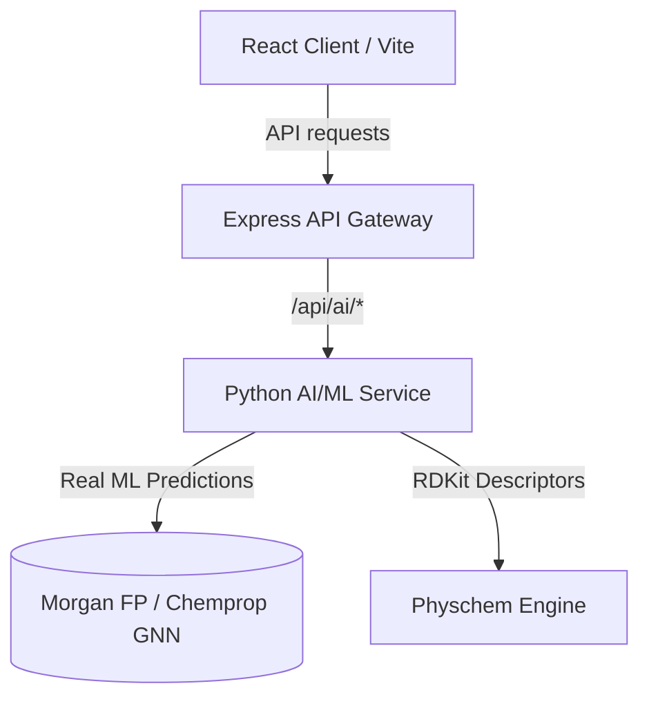

# Hakase BioTwin Preclinical Digital Twin Platform

Hakase BioTwin is a state-of-the-art, full-stack preclinical digital twin simulation platform. It integrates advanced physical chemistry analysis, structural mutagenicity scans, 3D molecule structural visualization, in silico/ex vivo safety assays, and high-fidelity Machine Learning model predictions (Graph Neural Networks and Random Forests) to profile drug candidates and evaluate regulatory IND readiness.

---

## 🏗️ Platform Architecture

The system is organized as a multi-tier microservice architecture:



### 1. **Frontend: React Application (`/artifacts/hakase-ai`)**
*   Built with React, Vite, TypeScript, and Framer Motion.
*   Uses a dark-mode glassmorphic design system for a premium scientific look.
*   Integrates `3dmol` for real-time 3D structural protein-ligand viewer interaction.
*   Communicates with the API gateway using relative endpoints (e.g. `/api/ai/*`), fully proxied in development mode.

### 2. **API Middleware: Express Gateway (`/artifacts/api-server`)**
*   Built with Express and TypeScript.
*   Handles request validation, database interactions (Drizzle ORM + SQLite), and therapeutic area modifiers.
*   Reverse proxies `/api/ai/*` to the downstream Python machine learning service.

### 3. **AI/ML Engine: Python Service (`/artifacts/ai-service`)**
*   Powered by Flask, RDKit, SciPy, and Scikit-Learn.
*   Performs structural pharmacophore scans (Ames mutagens, DILI risks, hERG block indicators).
*   Consists of three primary production-ready machine learning engines:
    *   **DILI-ML:** A Random Forest classifier trained on the FDA DILIrank dataset ($n=475$ compounds) utilizing Morgan fingerprints and RDKit descriptors.
    *   **CardioTox ML (DeepHIT):** A Random Forest model trained on ChEMBL ($n=655$ assays) to predict hERG channel blocking probabilities.
    *   **ADMET-AI:** A pre-trained deep Graph Neural Network (**Chemprop GNN ensemble**) predicting 41 endpoints directly from molecular structure.

---

## 🛠️ Developer Guide & Startup Instructions

Follow these detailed instructions to configure, install, and run the Hakase BioTwin platform locally.

### 1. **Prerequisites**
Ensure you have the following software installed on your machine:
*   **Node.js** (v20 or higher)
*   **pnpm** (Workspace package manager; do not use `npm` or `yarn`)
*   **Python** (v3.11 or higher)
*   **uv** (Fast Python package installer and resolver; highly recommended to avoid dependency conflicts)
*   **PostgreSQL** (Local or remote running instance accepting connections)
*   **Git & Git LFS** (Required for storing model weights and large datasets)

Make sure to initialize Git LFS and pull model weights after cloning:
```bash
git lfs install
git lfs pull
```

---

### 2. **Environment & Security Configuration (.env)**

> [!IMPORTANT]
> **CRITICAL SECURITY POLICY:** Local environment `.env` files contain sensitive API credentials, local database paths, and secrets. **They are ignored by Git and must NEVER be committed to the repository.**

#### Step A: Configure the Repository Root `.env`
1. Copy the reference configuration template:
   ```bash
   cp .env.example .env
   ```
2. Open the newly created `.env` file and set the required database URL (include your password if configured):
   ```env
   # PostgreSQL database connection URL (e.g. local DB named 'hakase_bio')
   DATABASE_URL=postgresql://<username>:<password>@localhost:5432/hakase_bio
   ```
3. Set Anthropic and RunPod bypass variables for local development (defaults to `DUMMY` to bypass API keys):
   ```env
   ANTHROPIC_API_KEY=DUMMY
   RUNPOD_API_KEY=DUMMY
   ```

#### Step B: Configure the Backend `.env`
Copy the template to the backend folder so the API gateway can read port and database settings:
```bash
cp backend/.env.example backend/.env
```
Ensure the `DATABASE_URL` matches the connection string configured in the root `.env`.

#### Step C: Enforce strict ML loading for Production (`STRICT_ML`)
By default, the Python machine learning service degrades gracefully—if ADMET-AI or other ML models cannot load (e.g. weights missing, import errors), they fall back to heuristic estimates and set `ml_available=false`. 

In **production deployments**, this silent fallback should be disabled to prevent serving heuristic results under an "ML-Enhanced" badge. Set the `STRICT_ML` flag in the root `.env` to enforce strict startup checks:
```env
STRICT_ML=1
```
When `STRICT_ML=1` is active:
* The FastAPI process will immediately **fail and crash at startup/warmup** if the ADMET-AI, CardioTox, or DILI-ML weights fail to load.
* Model weights for ADMET-AI are automatically downloaded on-demand from the official repositories on the first inference or when triggering the warmup endpoint:
  ```bash
  # Trigger model warmup and force pre-downloading/caching of weights
  curl -X POST http://localhost:8090/models/warmup
  ```

---

### 3. **Installation & Virtual Environment Setup**

#### Step A: Install Node.js Workspace Dependencies
From the repository root, install all monorepo dependencies:
```bash
pnpm install
```

#### Step B: Initialize the Python Virtual Environment
We use `uv` to resolve and synchronize Python packages cleanly. This ensures `rdkit` and `numpy` versions are aligned to NumPy 1.x (`numpy>=1.24.0,<2.0.0`) to prevent startup segmentation faults (`SIGSEGV`) and import errors:
```bash
# Create the virtual environment
uv venv .venv

# Sync dependencies based on the locked requirements
uv sync
```
*Note: If you do not use `uv`, you can manually create a standard python virtual environment and run `.venv/bin/pip install -r pyproject.toml`.*

---

### 4. **Database Migration**

1. Create the PostgreSQL database `hakase_bio` if it does not already exist:
   ```bash
   createdb hakase_bio
   # Or via psql: psql -c "CREATE DATABASE hakase_bio;"
   ```
2. Initialize the PostgreSQL database schema using Drizzle Kit. Run this command from the repository root:
   ```bash
   DATABASE_URL="postgresql://<username>:<password>@localhost:5432/hakase_bio" pnpm --filter @workspace/db run push
   ```
   This will automatically verify connection credentials and synchronize the table schemas.

---

### 5. **Starting the Services (Local Dev)**

You must run **two processes** concurrently. We recommend running them in separate terminal windows.

#### 🖲️ Terminal 1: Backend Orchestrator
From the repository root, start the single-command backend supervisor. 
> [!IMPORTANT]
> If you are running **Ersilia (local mode)**, prepend your virtual environment's binary directory to the `PATH` so the Python CLI can utilize the custom conda mock executable. This allows Ersilia to initialize correctly on any environment (such as macOS, Linux, or Windows) without needing a full Anaconda/Miniconda installation:

- **Linux / macOS (bash/zsh)**:
  ```bash
  PATH=".venv/bin:$PATH" pnpm run backend:dev
  ```
- **Windows (Command Prompt)**:
  ```cmd
  set PATH=.venv\Scripts;%PATH% && pnpm run backend:dev
  ```
- **Windows (PowerShell)**:
  ```powershell
  $env:PATH=".venv\Scripts;$env:PATH"; pnpm run backend:dev
  ```

The orchestrator will automatically boot and manage:
- **Express API Gateway:** listening on `http://localhost:3000`
- **FastAPI AI/ML Service:** listening on `http://localhost:8090` (and managing local Ersilia Docker instances if enabled).
- **Model Warm-Up & Hot-Reloads:** Automatically pre-warms the DILI, hERG, Ames, and Binding-ML models, and watches file changes.

#### 🎨 Terminal 2: Vite React Frontend (Development Mode Only)
From the repository root, start the frontend developer server on the permitted origin port (`4000`):
```bash
PORT=4000 pnpm run frontend:dev
```
*   **Vite Dev Server URL:** `http://localhost:4000`
*   Vite config automatically proxies all requests targeting `/api/*` to the gateway on port `3000` to prevent CORS issues.

#### 🚀 Production Hosting & Deployment (Single-Port Mode)
For hosting the app in production or deploying on cloud instances (e.g. AWS, Render, VM sandboxes, or Docker):
1. **Build and Start:** Run the single workspace start command. This automatically typechecks, compiles the React assets, builds the server bundles, and launches the backend services:
   ```bash
   PATH=".venv/bin:$PATH" pnpm start
   ```
2. **Access App:** The Express API server on port `3000` detects the frontend build and serves the React UI statically. You can access the entire application at **`http://localhost:3000`** (meaning you only need to expose a single port `3000` to the internet).

---

### 6. **Using the Ersilia Cell-Viability/Cytotoxicity Model (Optional)**

The platform integrates the **Ersilia cell-viability model (`eos9ei3`)** to predict live cytotoxicity ($CC_{50}$) and Therapeutic Index (TI) values in the `/lab` dashboard.

#### Prerequisites for Ersilia:
1. **Docker Desktop:** Must be running locally.
2. **Ersilia Python CLI:** Installed in your virtual environment (automatically handled via `uv sync` or `pip install -r pyproject.toml`).

#### Setup Steps:
1. **Configure Environment Variables:** Add the following lines to your root `.env` file to enable the local Ersilia Docker daemon:
   ```env
   HAKASE_ERSILIA_MODE=local
   HAKASE_ERSILIA_MODELS='{"cytotoxicity":"eos9ei3"}'
   HAKASE_ERSILIA_OUTPUT='{"cytotoxicity":{"kind":"cc50_uM","key":"cc50"}}'
   ```
   *(To disable or fall back to mock predictions, set `HAKASE_ERSILIA_MODE=off` or omit these lines).*

2. **Fetch the Model Weights:** Pull the container weights from the Ersilia Model Hub:
   ```bash
   .venv/bin/ersilia -v fetch eos9ei3
   ```

3. **Start the Backend:** Start with the path-prefix workaround so that Ersilia is tricked into bypassing its Conda dependency check:
   ```bash
   PATH=".venv/bin:$PATH" pnpm run backend:dev
   ```

---

## 🧪 Verification & Health Check

Once both services are running, verify communication via these health check endpoints:

1.  **AI/ML Service Health check:**
    ```bash
    curl -s http://localhost:8090/health
    # Expect: {"status":"ok","service":"HakaseAI AI Service","version":"1.0.0"}
    ```
2.  **API Server Gateway Health check:**
    ```bash
    curl -s http://localhost:3000/api/health
    # Expect: {"status":"ok"}
    ```
3.  **Vite Dev Proxy Health check:**
    ```bash
    curl -s http://localhost:4000/api/ai/health
    # Expect: {"status":"ok","service":"HakaseAI AI Service","version":"1.0.0"}
    ```

If all three verify successfully, open your browser to **`http://localhost:4000/`** (and log in or click "Access demo workspace" to navigate to **`/lab`**) to begin simulating digital twins!
